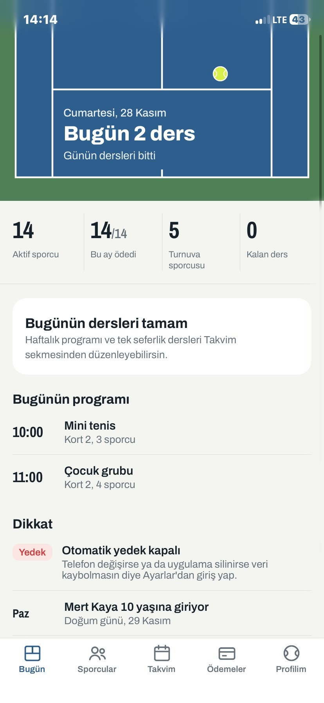
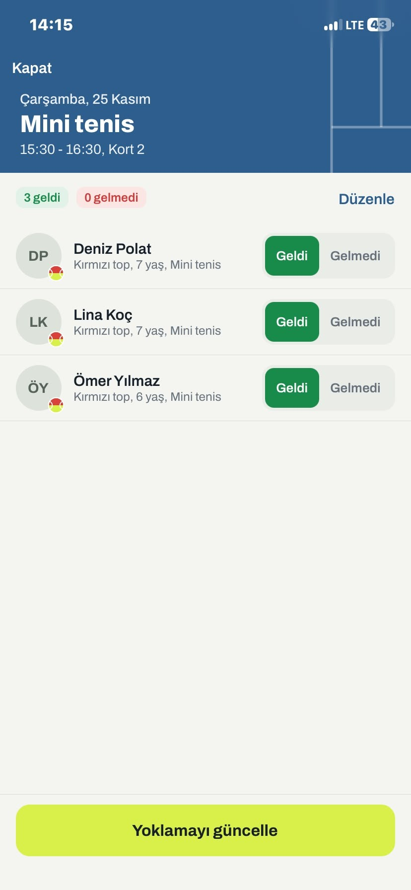
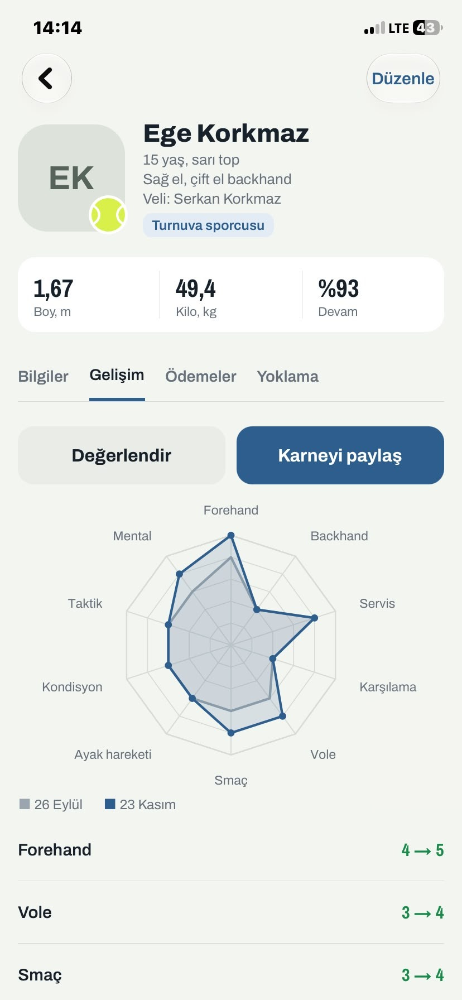
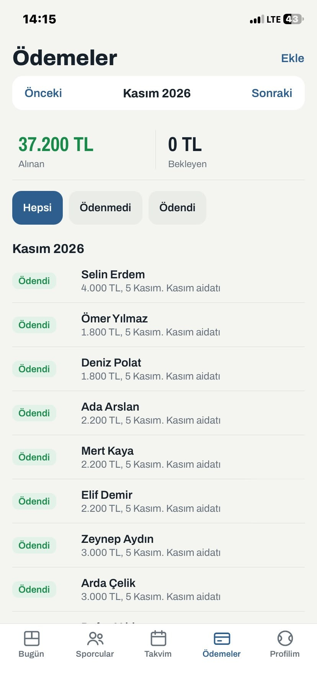

[English](README.md) | **Türkçe**

# Courtside

Tenis antrenörleri için iPhone ajandası: sporcular, ödeme takibi, haftalık dersler, yoklama, performans takibi, turnuvalar ve yerel hatırlatmalar. Bir tenis antrenörünün sahadaki günlük kullanımı için geliştirildi. Tüm veri telefonda durur, otomatik olarak buluta yedeklenir.

## Özellikler

- **Bugün:** Kortun üstten görünüşüyle günün ders sayısı, tek dokunuşla yoklama açılan sıradaki ders, günün geri kalanı, bu haftaki doğum günleri, geciken ödemeler ve yedek uyarıları.
- **Sporcular:** Fotoğraf, veli bilgileri, doğum tarihi, gerçek kırmızı, turuncu, yeşil ve sarı toplar olarak çizilen ITF top evresi, oynadığı el, tek ya da çift el backhand, grup, başlama tarihi, turnuva işareti, notlar. Boy ve kilo geçmiş olarak tutulur, gelişim grafiği çıkar.
- **Yoklama:** Herkes geldi olarak başlar, hoca yalnızca gelmeyenlere dokunur. Ders yağmur yüzünden iptal edilebilir, telafi dersi eklenebilir. Her sporcunun devam oranı görünür.
- **Takvim:** Her hafta tekrar eden grup ve özel dersler ile tek seferlik dersler, hafta hafta.
- **Ödemeler:** Tarih, tutar, ödendi bilgisi ve notla serbest kayıt. Ödendi yeşil, ödenmedi sarı, gecikti kırmızı. Bir kayıt aynı anda birden çok sporcu için açılabilir; ödenmemiş kayıttan veliye hazır yazılmış WhatsApp hatırlatması gider.
- **Performans:** Forehand, backhand, servis, karşılama, vole, smaç, ayak hareketi, kondisyon, taktik ve mental 1 ile 5 arasında puanlanır. Hoca metrikleri yeniden adlandırabilir, ekleyebilir ya da kapatabilir. Son iki değerlendirme radar grafikte üst üste çizilir, gelişim karnesi görsel olarak veliye paylaşılır.
- **Turnuvalar:** Turnuvalar, katılan sporcular ve sonuçları; her sporcunun profilinde de listelenir.
- **Profilim:** Hocanın fotoğrafı, tanıtımı, deneyimi, sertifikaları, WhatsApp ve Instagram bağlantıları; velilere gösterilmek üzere tasarlandı.
- **Bildirimler:** Dersleri, ödeme günlerini ve doğum günlerini içeren sabah özeti ile ders öncesi hatırlatma. Bildirimler sunucusuz, telefonda zamanlanan yerel bildirimlerdir.
- **Yedek:** Her değişiklikten sonra veritabanının tamamı tek JSON dosyası olarak, yeni fotoğraflar da bir kez yüklenir. Son 30 yedek saklanır, herhangi biri geri yüklenebilir.

## Ekran Görüntüleri

| Bugün | Yoklama | Gelişim | Ödemeler |
|---|---|---|---|
|  |  |  |  |

## Kullanılan Teknolojiler

- Expo SDK 58, React Native, TypeScript, Expo Router
- Telefondaki veri için sürümlü göçlerle expo-sqlite
- Yerel hatırlatmalar için expo-notifications
- Otomatik yedek için Row Level Security ile korunan Supabase Auth ve Storage
- Kort çizimi, radar ve gelişim grafikleri için react-native-svg
- Gelişim karnesi için react-native-view-shot ve expo-sharing
- İş kuralları için Vitest

## Kurulum ve Çalıştırma

```bash
npm install
cp .env.example .env
npx expo start
```

Uygulamayı Expo Go'da açmak için QR kodu iPhone kamerasıyla okut.

Yedek için ücretsiz bir Supabase projesi gerekir:

1. SQL Editor'da `docs/supabase.sql` dosyasını çalıştır. Özel `yedek` kovasını ve erişim kurallarını kurar.
2. Authentication sayfasından yeni kaydı kapat ve hocanın kullanıcısını oluştur.
3. Proje adresini ve yayınlanabilir anahtarı `.env` dosyasına yaz.

Uygulama tek bir iPhone'a ad hoc EAS derlemesiyle kurulur:

```bash
eas device:create
eas build --profile preview --platform ios
eas update --channel preview
```

## Öğrendiklerim

İlk sürümle eklenecek.
